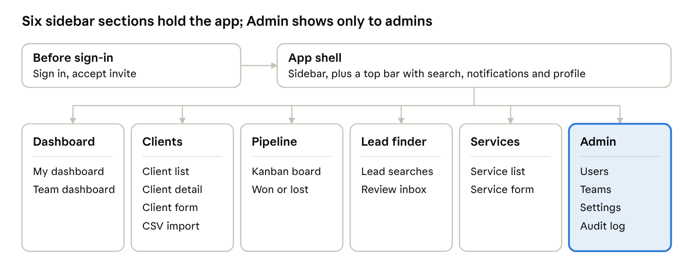
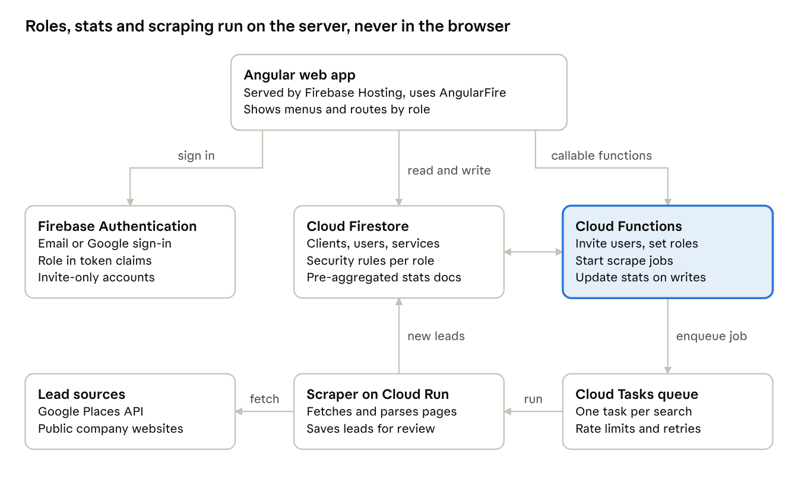
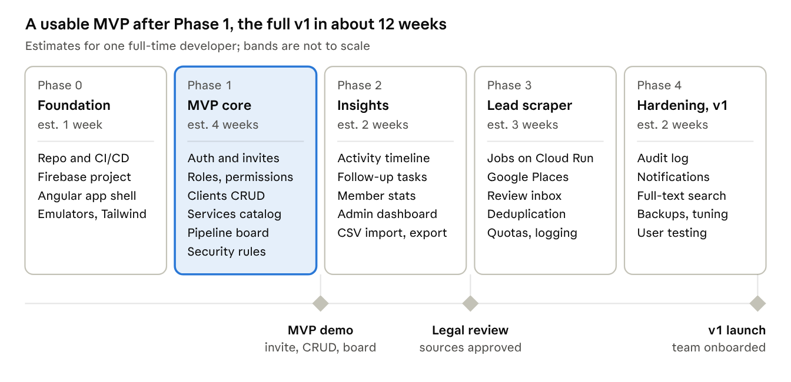

# Klosers CRM: Initial Planning Document

Nov 21, 2026

## Overview

Klosers CRM is a web app where a sales team keeps its clients in one place, finds new leads with a scraper, moves deals across a pipeline board, and tracks results. It runs on Angular and Firebase, and an admin controls access through roles and per-user permissions.

**Goals for the first version**

- One shared client database per team, replacing spreadsheets.
- Admins decide who can see and change what, per role and per user.
- Every member sees their own numbers; admins see the whole team.
- The scraper feeds new leads into a review inbox before they reach the database.
- The services the team sells are documented in the app and linked to clients and sales.

**Done means** an admin can invite a member, the member can sign in and work clients on the board, and both see accurate statistics for a chosen period.

**Scope:** an internal tool for one company and its sales teams, running in a single production environment.

## Roles and permissions

Three roles cover the brief: Admin, Team lead and Member. Each role gives a default set of permissions, and an admin can switch individual permissions on or off for any user.

- **Admin** runs the whole organization: users, teams, permissions, services, pipeline stages and every dashboard.
- **Team lead** manages one team's clients and sees that team's dashboard. This role is optional; see the open questions.
- **Member** is a salesperson who works their own clients and sees their own statistics.

| Permission | Admin | Team lead | Member |
| --- | --- | --- | --- |
| Invite and deactivate users | Yes | No | No |
| Assign roles and permissions | Yes | No | No |
| Create and edit teams | Yes | No | No |
| Manage the services catalog | Yes | View | View |
| Configure pipeline stages | Yes | No | No |
| Create clients | Yes | Yes | Yes |
| Edit clients | All | Own team | Own |
| Delete clients (soft delete) | All | Own team | No |
| Reassign a client's owner | All | Own team | No |
| Run the scraper | Yes | Yes | Optional |
| Import and export CSV | Yes | Own team | No |
| See own statistics | Yes | Yes | Yes |
| See team totals | All teams | Own team | Optional |
| See the per-member dashboard | All teams | Own team | No |
| Read the audit log | Yes | No | No |

"Optional" means off by default, and an admin can turn it on per user.

## Functional modules

The first version has eight modules. I read "board to administrate" as two things, the pipeline board and the admin panel, and planned both.

### 1. Authentication

- Email and password sign-in, plus Google sign-in that can be limited to the company's email domain.
- Invite-only: an account exists only after an admin invites that email. There is no public sign-up.
- Password reset and email verification. Two-factor sign-in can come later.
- A deactivated user is blocked at sign-in and loses access at once.

### 2. Admin panel: users and teams

- Invite a user by email, choose their team and role, and adjust individual permissions.
- Create teams and name a team lead.
- Deactivate users instead of deleting them, so their history stays intact.
- Reassign a departing user's clients to someone else in one step.

### 3. Clients database and CRUD

- Client fields: company name, contact person, email, phone, website, industry, city, country, source, stage, owner, services of interest, estimated value, tags, notes and next follow-up date.
- List view with search, filters (stage, owner, service, source, tag), sorting and pagination.
- Detail page with an activity timeline: notes, calls, emails, meetings and stage changes.
- A duplicate warning when the email, phone or website domain already exists.
- Bulk actions: assign owner, change stage, add tag, delete.
- Soft delete with restore, so mistakes can be undone.

### 4. Lead scraper

- A user defines a search: source, keywords, location and industry.
- The search runs in the background and shows its progress.
- Results land in a review inbox, not straight in the database.
- The user accepts or rejects each lead. Accepted leads become clients with the source "scraper".
- Sources, deduplication and legal limits are covered in the scraper section.

### 5. Pipeline board

- A Kanban board with one column per stage: New, Contacted, Qualified, Proposal, Negotiation, Won, Lost.
- Dragging a card changes its stage and logs the change in the client's timeline.
- Cards show company, estimated value, owner, service and next follow-up.
- Filters by owner, team and service. Admins can rename, add and reorder stages.
- Moving a card to Won asks for the final value; moving it to Lost asks for a reason.

### 6. Member statistics

- Each user sees their own KPIs for a chosen period, plus team totals when an admin allows it.

### 7. Admin dashboard

- Every KPI for the whole organization, broken down per member, per team and per service.

### 8. Services catalog

- Admins record each service the team sells: name, description, price or price range, currency, category and an active flag.
- Optional links to sales material such as brochures or presentations.
- Clients and won deals link to one or more services, which powers sales-by-service statistics.
- Every member can read the catalog when answering a client's questions.

## Features and screens for design

The app has 20 screens: two before sign-in, 16 in six sidebar sections, and profile and notifications in the top bar. This section is the brief for the designer, and the UI will be built with Tailwind CSS on Angular.

### Design constraints

- Deliver the visual system as a Tailwind theme: color palette, font family and sizes, spacing, border radius and shadows.
- Design components that can be built from Tailwind utilities; the Angular CDK handles drag and drop, dialogs and menus.
- Desktop first, and every screen must still work at phone width.
- One language only, and text contrast must meet WCAG 2.1 AA.
- Controls a user has no permission for are hidden, not just disabled.
- Still needed from the owner: logo, brand colors, and whether dark mode is wanted.

### Sitemap

Members and team leads see the first five sections. The Team dashboard shows only to admins and team leads.

### Screens

| Screen | Phase | Who uses it | What it shows | Main actions |
| --- | --- | --- | --- | --- |
| Sign in | 1 | Everyone | Email and password form, Google button, forgot-password link | Sign in, reset password |
| Accept invite | 1 | Invited users | Welcome message, assigned team and role, password fields | Create account |
| My dashboard | 2 | Everyone | KPI cards, won-revenue trend, overdue follow-ups, today's tasks | Change period, open a client |
| Team dashboard | 2 | Admins, team leads | KPIs per team and member, leaderboard, pipeline funnel, sales by service | Filter by date, team, member and service |
| Client list | 1 | Everyone | Searchable table with filters, sorting, pagination and stage badges | Add client, bulk assign, bulk stage change, delete |
| Client detail | 1 | Everyone | Contact data, stage, owner, services and value; activity timeline from Phase 2 | Edit, change stage, log activity, set follow-up |
| Client form | 1 | Everyone | Client fields with validation and a duplicate warning | Save, cancel |
| CSV import | 2 | Admins, team leads | File upload, column mapping, preview with row errors | Import, download template |
| Kanban board | 1 | Everyone | One column per stage, client cards, value total per column | Drag cards, filter, quick add |
| Won or lost | 1 | Everyone | Dialog asking for the final value or the loss reason | Confirm, cancel |
| Lead searches | 3 | Users allowed to scrape | Search form, past searches with status and progress | Start a search, open results |
| Review inbox | 3 | Users allowed to scrape | Leads from one search, with duplicate flags | Accept, reject, accept all |
| Service list | 1 | Everyone | Services with price range, category and active flag | Open a service; admins add and edit |
| Service form | 1 | Admins | Service fields and links to sales material | Save, deactivate |
| Users | 1 | Admins | User table with role, team and status; per-user permission switches | Invite, change role, toggle permissions, deactivate, reassign clients |
| Teams | 1 | Admins | Teams with their lead and members | Create team, set lead, move members |
| Settings | 1 | Admins | Pipeline stages, loss reasons, currency | Add, rename and reorder stages |
| Audit log | 4 | Admins | Filterable list of who changed what, and when | Filter, open the changed record |
| Profile | 1 | Everyone | Name, email, password | Edit, sign out |
| Notifications | 4 | Everyone | New assignments, overdue follow-ups, finished searches | Open, mark as read |

### Shared components

- **App shell:** collapsible sidebar, and a top bar with global search (Phase 4), notifications and the user menu.
- **Data table:** search box, filter chips, sortable columns, pagination and a bulk-action bar.
- **Charts and KPIs:** KPI card, line chart, bar chart and funnel.
- **Board:** Kanban column with a value total, and a draggable client card.
- **Badges:** stage, role and status.
- **Timeline item:** note, call, email, meeting and stage change.
- **Permission switches:** a grid of on/off toggles per user.
- **Overlays and forms:** modal, side drawer, confirm dialog, toast, and form fields with error messages.

### States every screen needs

- Empty, loading and error states for every list, board and dashboard.
- Validation errors on every form.
- A "no access" page for routes the user cannot open.
- Layouts at desktop, tablet and phone widths.

## Tech stack and architecture

The app is a single-page Angular app that talks to Firebase directly, with Cloud Functions for anything privileged and a Cloud Run worker for the scraper. No custom backend server is needed.

| Layer | Choice | Why |
| --- | --- | --- |
| Frontend | Latest stable Angular, standalone components and signals | Requested; typed and well structured |
| UI components | Tailwind CSS, plus Angular CDK for drag and drop, dialogs and menus | Utility classes map straight to the design's tokens; the CDK adds accessible behavior and powers the board |
| Firebase SDK | AngularFire | Official Angular bindings for Auth, Firestore and Functions |
| Charts | ngx-echarts or ng2-charts | Line, bar and funnel charts |
| Authentication | Firebase Authentication | Email and Google sign-in, custom claims for roles |
| Database | Cloud Firestore | Live updates for the board, offline cache, security rules |
| Server logic | Cloud Functions for Firebase, 2nd gen, TypeScript | Invites, roles, stats triggers, scraper jobs |
| Scraper | Cloud Run worker fed by Cloud Tasks | Long jobs, headless browser, rate limits |
| Files | Cloud Storage for Firebase | CSV imports and attachments |
| Hosting | Firebase Hosting | Serves the app; server-side rendering is not needed behind a login |
| Email | Firebase Trigger Email extension with SendGrid or Mailgun | Invites and notifications |
| Search, v1 | Algolia or Typesense extension | Full-text search |

One repository holds four parts: the Angular app, the Cloud Functions, the scraper worker, and the Firestore rules and indexes.

The browser reads and writes Firestore directly, guarded by security rules. Anything that changes roles, counts statistics or calls outside sites goes through Cloud Functions.

## Firestore data model

Because this is an internal tool for one company, every collection sits at the top level and company-wide settings live in one document.

| Path | Holds | Key fields |
| --- | --- | --- |
| `settings/app` | Company-wide settings | companyName, currency, timezone, pipelineStages[], lossReasons[] |
| `users/{uid}` | One user profile | teamId, displayName, email, role, permissions{}, status, lastLoginAt |
| `teams/{teamId}` | A sales team | name, leadUid, memberCount |
| `invitations/{inviteId}` | Pending invites | email, role, teamId, invitedBy, expiresAt, status |
| `clients/{clientId}` | A client or lead | companyName, contactName, email, phone, website, industry, city, country, stage, ownerUid, teamId, serviceIds[], estimatedValue, closedValue, lossReason, source, tags[], nextFollowUpAt, searchTokens[], createdAt, updatedAt, deletedAt |
| `clients/{clientId}/activities/{activityId}` | Timeline entries | type, body, authorUid, fromStage, toStage, createdAt |
| `services/{serviceId}` | Services the team sells | name, description, priceMin, priceMax, currency, category, active, materialUrls[] |
| `scrapeJobs/{jobId}` | One scraper run | createdBy, source, query{}, status, progress, resultCount, startedAt, finishedAt, error |
| `scrapeJobs/{jobId}/leads/{leadId}` | Leads waiting for review | raw{}, normalized{}, duplicateOfClientId, reviewStatus, reviewedBy |
| `stats/{scope_period}` | Pre-aggregated numbers | scope (company, team or user), period, countsByStage{}, pipelineValue, wonValue, wonCount, lostCount, activities, byService{} |
| `auditLog/{entryId}` | Who changed what | actorUid, action, targetPath, before{}, after{}, at |

- **Indexes:** composite indexes for team + stage + last update, owner + next follow-up, and stage + owner.
- **Search:** Firestore has no full-text search. The MVP matches lowercase word prefixes stored in searchTokens; v1 can add Algolia or Typesense through a Firebase Extension.
- **Deals:** if one client can buy several services over time, stage and value move to a separate deals collection. This is an open question below.

## Security and access control

Every Firestore rule starts from deny, and the browser can never grant itself a role. Hiding a button in Angular is only cosmetic; the rules are what actually protect the data.

- **Role in the token.** A Cloud Function sets the role as a custom claim on the user's Firebase Auth token. Only server code can write claims.
- **Fine-grained permissions.** Per-user switches live in the user's profile under permissions. Rules read them, and small flags can also be copied into the claims.
- **Fast role changes.** After a role change the function writes a timestamp that the app listens to, and the app refreshes its token. The new role applies within seconds instead of up to an hour.
- **Rules per path.** Every path checks that the user is signed in and active. Members edit only clients they own, team leads edit their team's clients, and no one but an admin can change a client's owner.
- **Field validation.** Rules check types, required fields and allowed stages. Deletes from the app are soft: they set deletedAt.
- **Privileged actions on the server.** Inviting, changing roles, deactivating users, starting the scraper, bulk import and permanent deletes run only through callable Cloud Functions.
- **App Check.** Firebase App Check with reCAPTCHA Enterprise rejects requests that do not come from the real app.
- **Audit log.** Only Cloud Functions write it, and the rules block every write from the browser.
- **Tests before deploy.** Rules and functions are tested in the Firebase Emulator Suite on every pull request.
- **Client privacy.** Clients' personal data can be exported or deleted on request, and a "do not contact" flag blocks outreach.

## Lead scraper

The scraper should start with official data APIs and public company websites, not social networks. That keeps it legal, stable and cheaper to maintain.

**How a search runs**

1. A user fills in the search form: source, keywords, location and industry.
2. A callable Cloud Function checks the user's permission and the organization's daily quota, then creates a job with the status "queued".
3. The function puts the job on a Cloud Tasks queue, which controls the request rate and retries failures.
4. A worker on Cloud Run fetches and parses the data and updates the job's progress. It uses plain HTTP where possible and a headless browser (Playwright) only for pages that need JavaScript.
5. Each lead is normalized and checked against existing clients, then saved in the job's leads list.
6. The user reviews the inbox. Accepted leads become clients with the source "scraper" and a link to the job.

**Candidate sources**

| Source | What it gives | Notes |
| --- | --- | --- |
| Google Places API | Business name, address, phone, website, category, rating | Official and paid per request. Google's terms limit how long most Places data may be stored, so legal review must confirm what we keep. |
| Company websites | Emails and phones from contact pages | Respect robots.txt and rate-limit each domain. |
| Public business directories | Companies by industry and city | Check each site's terms before using it. |
| Email enrichment APIs, such as Hunter or Apollo | Verified business emails | Paid, with clear usage terms. |
| LinkedIn | Not recommended | Its terms forbid scraping, and accounts get banned. |

**Deduplication.** Emails are lowercased, phones are converted to international format, websites are reduced to their root domain, and company names lose legal suffixes. A match on any of these flags the lead as a possible duplicate.

**Compliance.** Each lead stores its source and the date it was collected. Cold outreach must follow the data-protection and anti-spam laws of each target country. A legal review of the chosen sources is a gate before the scraper ships.

## Dashboards and KPIs

Members see their own numbers, and admins see every number broken down per member, team and service. All views filter by date range, team, member and service.

| KPI | How it is calculated | Member sees | Admin sees |
| --- | --- | --- | --- |
| New clients | Clients created in the period | Own | Per member and team |
| Pipeline by stage | Open clients counted per stage | Own | All |
| Pipeline value | Sum of estimated value of open clients | Own | All |
| Won revenue | Sum of final value of clients moved to Won in the period | Own | All |
| Win rate | Won ÷ (Won + Lost) in the period | Own | All |
| Average days to close | Days from creation to Won | Own | All |
| Activities logged | Calls, emails, meetings and notes | Own | All |
| Overdue follow-ups | Clients whose next follow-up date has passed | Own | All |
| Sales by service | Won revenue per service | Own | All |
| Scraper yield | Leads accepted ÷ leads found | Own | All |
| Leaderboard | Members ranked by won revenue | Optional | Yes |

- **Charts:** a line for trends over time, a funnel for the pipeline stages, and bars per member and per service. ngx-echarts or ng2-charts both work in Angular.
- **How the numbers stay cheap:** Cloud Function triggers update the stats documents whenever a client or activity changes. A dashboard then reads a handful of documents instead of every client, which keeps Firestore costs low.
- **Ad-hoc numbers:** Firestore's built-in count and sum queries cover one-off figures without extra code.

## Non-functional requirements

These are proposed targets for the first version; adjust them once the expected number of users is known.

| Area | Requirement |
| --- | --- |
| Devices | Responsive layout, designed for desktop first and usable on tablets and phones |
| Performance | Lists load 25 rows per page; dashboards load in under 2 seconds on a normal connection |
| Languages | One language only; no internationalization framework is needed |
| Accessibility | WCAG 2.1 AA: full keyboard use, readable contrast, labelled fields |
| Environments | One Firebase project, production only; developers work locally on the Firebase Emulator Suite, so tests never touch live data |
| CI/CD | GitHub Actions runs lint, unit tests, rules tests and the build on every pull request, and deploys to production when it merges to main |
| Testing | Unit tests for components and services, Emulator Suite tests for rules and functions, Playwright end-to-end tests for the key flows |
| Backups | Not needed for the MVP; daily Firestore exports and point-in-time recovery can be added in Phase 4 |
| Monitoring | Kept minimal: Cloud Functions logs in the Firebase console and a budget alert |
| Cost | The Firebase Blaze plan is required for Cloud Functions, Cloud Run and outbound requests; a budget alert is set from day one |
| Data protection | Google encrypts data in transit and at rest; client data can be exported or deleted on request |

## Roadmap

Five phases take the CRM from an empty repository to v1 in about 12 weeks, and the team can start using the MVP after week 5.

The legal review sits before the scraper phase, so no scraper code is built for sources that turn out to be off limits. With a second developer, Phases 2 and 3 can run side by side and v1 lands in about 10 weeks.

## What else we need

The brief is missing a few features that almost every CRM needs, and several decisions only you can make. The features below are already in the roadmap; the decisions should be settled before Phase 1 starts.

### Recommended additions

- **Follow-up tasks and reminders,** so no lead goes cold.
- **Activity timeline per client,** recording calls, emails, meetings and notes.
- **Notifications** in the app and by email: new client assigned, follow-up overdue, scraper finished.
- **CSV import and export,** to migrate the spreadsheets the team uses today.
- **Global search** across clients, contacts and services.
- **Audit log** of sensitive changes such as roles, ownership and deletes.
- **Later:** Gmail and Outlook integration, WhatsApp click-to-chat links, quotes generated from the services catalog, and a mobile app.

### Decisions needed

- [ ] Does "board to administrate" mean the pipeline Kanban, the admin panel, or both?
- [ ] Can members see teammates' clients, or only their own?
- [ ] Do we need the Team lead role?
- [ ] Is one client one deal, or can a client have several deals over time?
- [ ] What are the final pipeline stages and loss reasons?
- [ ] Which scraper sources, countries and cities come first?
- [ ] What monthly budget is there for paid APIs such as Google Places?
- [ ] Which language and currency does the app use?
- [ ] Which sign-in methods: email and password, Google, or both?
- [ ] How many users and clients are expected in the first year?
- [ ] What is the target date for the MVP?
- [ ] Is there branding ready: logo, colors, domain?

## Risks and mitigations

The scraper carries the most risk, which is why it comes after the MVP and behind a legal review.

| Risk | What happens | Mitigation |
| --- | --- | --- |
| Scraping breaks a site's terms or a privacy law | Blocked accounts, legal claims | Official APIs first, legal review gate, source stored per lead, do-not-contact flag |
| Sites block or change their pages | Scraper returns nothing | API-first sources, retries through Cloud Tasks, failed jobs flagged in the app |
| A rules mistake leaks data between users | Members see clients they should not | Deny by default, Emulator rules tests in CI, server-only role changes |
| Dashboards read too many documents | Firestore bill grows with every visit | Pre-aggregated stats documents, budget alerts |
| Firestore cannot do full-text search | Users cannot find clients by partial words | Prefix tokens for the MVP, Algolia or Typesense in v1 |
| A changed role stays in the old token | User keeps old access for up to an hour | Forced token refresh after every role change |
| Scope grows before launch | MVP slips | Phased roadmap; new ideas go to the later list |
| A bad deploy or a manual test changes live data | Clients or stats are corrupted, with no staging copy to catch it first | Emulator tests in CI and deploys only from CI; backups are added in Phase 4 |
